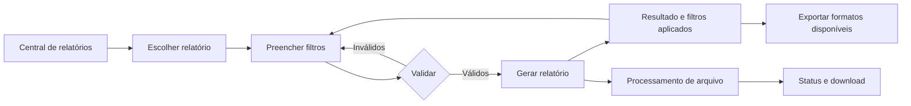

# Refatoração dos relatórios

## Resultado esperado

O usuário deve conseguir encontrar um relatório pelo assunto ou pela busca, entender o que ele mede, selecionar filtros pesquisáveis e gerar o resultado de maneira previsível. A navegação e os controles devem ser consistentes entre relatórios, sem alterar silenciosamente fórmulas, permissões e abrangência dos dados.

Este é um plano de produto e implementação baseado em leitura de código local. A entrega desta demanda é o planejamento; a implementação permanece pendente. Não houve inspeção autenticada das telas, consulta SQL, acesso remoto nem publicação. O [inventário](inventory.md) registra a base técnica e as limitações de cada conclusão.

## Diagnóstico

1. O ponto de entrada chamado “Relatórios” abre um seletor de relatórios em `/reports/dashboard`, enquanto outros relatórios aparecem diretamente no menu. O usuário precisa conhecer dois caminhos.
2. “Performance Operadores” e “Dashboard: WhatsApp” apontam para a mesma rota, com regras de exibição distintas. Há outras telas com assuntos próximos cuja equivalência de métricas precisa ser verificada antes de qualquer fusão.
3. Há seletores de operadores e setores sem pesquisa, filtros pesquisáveis já existentes em Conversas e componentes HTML externos com pesquisa própria. O problema é de cobertura e padronização, não ausência total de busca.
4. Alguns filtros disparam consulta ao mudar datas; outros exigem Buscar, Atualizar ou Recarregar. Conversas usa Exportar para iniciar um processamento assíncrono. Não há um contrato comum de estado e ações.
5. Parte dos relatórios é renderizada pelo CRM, parte por HTML em iframe e parte pelo `reports-frontend`. Páginas disponíveis por URL nem sempre têm entrada no menu.
6. O componente Funil de Vendas contém valores fixos na base `homolog` analisada. Deve ser tratado como demonstração até validar uma fonte real. Não concluir, a partir disso, que a produção usa esse mesmo artefato.

## Navegação proposta

### Uma entrada principal: Relatórios

Criar `/{instance}/reports` como central. Ela terá busca “Buscar relatório”, categorias e cards/lista com nome, descrição curta, tipo de saída e disponibilidade. No menu principal, Relatórios abre a central; dentro da área, a navegação apresenta Central e as categorias. No celular, as categorias ficam em um seletor compacto. Evitar uma árvore profunda e um segundo menu que duplique todos os relatórios.

| Categoria | Conteúdo proposto |
|---|---|
| Atendimento e WhatsApp | Mensagens por operador, por contato, por hora/dia, contatos aguardando retorno, desempenho geral, desempenho por operador e exportação de conversas |
| Comercial | Vendas, metas e indicadores, equipe x metas, origem x qualidade, motivos de perda; Funil de Vendas somente após validar a fonte |
| Carteiras e campanhas | Análise de Mailing e Régua por Carteira, mantendo a habilitação atual até validar disponibilidade |
| Qualidade | Pesquisa de Satisfação e futuras análises de qualidade; preservar a restrição atual da Exatron |
| Personalizados | Relatórios salvos e rascunhos privados visíveis ao usuário, com identificação clara de cada estado |

Dashboards configuráveis, métricas e SQL ficam em uma seção secundária “Ferramentas de relatórios”, apenas para os perfis e tenants já autorizados. Configurar uma métrica ou escrever SQL não deve ser uma etapa exigida para consultar um relatório pronto. Itens hoje ocultos não serão habilitados por causa da reorganização.

Regras do catálogo:

- Busca por título, descrição, categoria e sinônimos, ignorando caixa e acentos. Exemplos: “WhatsApp”, “operador”, “faturamento”, “satisfacao”.
- Um ID estável por relatório, independente de título, índice no menu e URL. Deduplicar a mesma rota, conservando como sinônimos os nomes antigos; para o destino compartilhado, manter a união das condições atuais de visibilidade e exigir a autorização efetiva da rota/API.
- Sub-relatórios hoje escondidos no seletor de `/reports/dashboard` ganham cards próprios e links diretos. O seletor deixa de ser o caminho obrigatório.
- Breadcrumb `Relatórios > Categoria > Nome` e ação “Todos os relatórios”. Voltar preserva a busca/categoria e não dispara geração.
- Reaproveitar as rotas existentes na primeira onda. Links antigos, inclusive `?report=satisfactionSurvey`, continuam resolvendo o mesmo relatório. Criar redirects explícitos somente ao substituir uma rota.
- Catálogo, menu, acesso direto e APIs devem respeitar tenant, perfil, módulos e feature flags. Ocultar no catálogo não substitui autorização no servidor.
- Favoritos e recentes são melhoria posterior. Se implementados, isolar por tenant/usuário e não armazenar consultas completas ou dados dos resultados como preferência.

## Fluxo padrão: filtrar e gerar

### Estrutura de cada tela

1. Cabeçalho com nome, objetivo, breadcrumb e ajuda sobre métricas e período de referência.
2. Área de filtros com período e campos principais visíveis; “Mais filtros” apenas para campos secundários. Não esconder os campos essenciais atrás de um modal.
3. Ação primária única **Gerar relatório**; para fluxos exclusivamente de arquivo, **Gerar arquivo**. **Limpar filtros** restaura os padrões declarados e deixa as alterações pendentes. **Atualizar resultado** repete explicitamente os últimos filtros aplicados, sem absorver alterações ainda não geradas.
4. Resumo dos filtros efetivamente aplicados, horário da consulta, quantidade de registros quando conhecida e avisos de truncamento/parcialidade.
5. Resultado em tabela, gráfico ou indicadores, com detalhamento onde já existe. Exportação é ação secundária, disponível somente nos formatos suportados e sobre o contexto efetivamente aplicado.

Não impor um wizard de várias páginas. É uma tela contínua, com a mesma ordem de ações em todos os relatórios.

### Filtros em edição e filtros aplicados

- Separar `draftFilters` de `appliedFilters`. Digitar, escolher opções e usar atalhos de período alteram só o rascunho; não executam a consulta de resultados.
- Na abertura normal, carregar metadados/opções e apresentar “Defina os filtros e gere o relatório”. Não iniciar consultas pesadas automaticamente. Reabrir uma URL com filtros preenche o formulário; a execução continua explícita.
- Ao gerar: validar, capturar filtros normalizados e fazer uma execução lógica. Uma execução pode chamar múltiplos endpoints já necessários; não duplicar a mesma requisição por efeito React e submit.
- Alterações posteriores exibem “Filtros alterados. Gere novamente para atualizar”. O resultado anterior continua identificado com seus filtros; exportar fica indisponível até gerar novamente ou descartar as alterações.
- Exibir o último resultado durante atualização com indicação de carregamento. Em erro, mantê-lo identificado como anterior, sem apresentá-lo como sucesso da nova consulta.
- Remover um chip altera o rascunho e pede nova geração. Limpar não significa buscar todo o histórico.
- Uma resposta antiga não pode sobrescrever uma execução mais recente. Usar cancelamento onde suportado ou controle de sequência; desabilitar o envio duplicado durante processamento.
- Ao trocar tenant, usuário ou relatório, cancelar/ignorar respostas pendentes e descartar estado que não pertence ao novo contexto.

### Três pesquisas diferentes

| Pesquisa | Comportamento |
|---|---|
| Encontrar relatório | Pesquisa no catálogo, sem consultar resultados de negócio |
| Encontrar opção de filtro | Combobox pesquisável para operador, setor, carteira, campanha, cliente, contato e demais listas extensas |
| Pesquisar nos resultados | Campo próprio em tabelas e históricos; declarar se pesquisa o conjunto inteiro no servidor ou apenas resultados já carregados |

Requisitos dos campos:

- Listas de entidades devem permitir busca por nome e código; cliente/contato também pelos identificadores que a API efetivamente suporta. Não exigir que o usuário saiba um ID numérico.
- Pequenos enums fixos, como Canal, Situação, Formato e Agrupamento, podem continuar como select simples.
- Multisseleção com chips, quantidade selecionada e opção explícita “Todos os permitidos”. Buscar opções não apaga seleções fora da página atual. Diferenciar “nenhum selecionado” de “todos” quando o contrato exigir.
- “Selecionar todos os encontrados” deve informar se vale para a página ou para toda a pesquisa; não usar “Todos” para indicar apenas as opções carregadas.
- Buscar opções localmente apenas quando a coleção inteira for pequena e conhecida. Para grandes listas, usar pesquisa/paginação no servidor, debounce inicial de 300 ms, cache por tenant/usuário e tratamento de respostas fora de ordem. Verificar APIs existentes antes de criar novas.
- Opções de operadores e setores vêm do catálogo autorizado, não das linhas retornadas pelo relatório. Em Vendas, corrigir a dependência atual de `data.byOperator`, que impede selecionar entidades sem resultado no recorte.
- Campos dependentes, como campanha/carteira e setor/operador, só terão dependência aplicada quando confirmada pelo domínio/API. Ao invalidar seleção, informar a alteração; não apagar silenciosamente.
- Formulários acessíveis por teclado, labels permanentes, feedback de carregamento, falha ao carregar opções, sem opções e sem correspondência. Texto livre no combobox não deve virar ID inexistente.

### Período e validação

- Relatórios com período começam com “Este mês até hoje”, salvo exceção de negócio documentada. Atalhos: Hoje, Ontem, Últimos 7 dias, Este mês, Mês anterior e Personalizado. Atalho só preenche os campos.
- Relatórios de situação atual, como contatos aguardando retorno, identificam “Posição na consulta” e não recebem datas sem suporte real.
- Documentar por relatório qual data é filtrada: mensagem, atendimento, encerramento, cadastro ou faturamento. Não presumir que startDate/endDate significam a mesma coisa em todas as APIs.
- Validar início/fim, ordem, valores obrigatórios e limites. Meses, comparação com período anterior e metas mensais preservam suas regras; intervalos de vários meses precisam de decisão explícita para a meta comparada.
- Usar o fuso de negócio configurado; validar o fallback atual antes da migração. Não converter datas civis com `toISOString()` sem conferir o efeito de UTC. Preservar a semântica inclusiva/exclusiva da API por adaptador e testar limites de dia/mês.
- Não transportar automaticamente o intervalo 2000–2099 usado hoje como fallback. Definir limite seguro por relatório com medição e validação de negócio; não inventar um teto global.

### Resultados e arquivos

- Estados comuns: aguardando geração, validando, carregando, sucesso, vazio, erro, indisponível, sem permissão e resultado parcial. Zero linhas é uma consulta concluída, não uma falha.
- Tabelas extensas devem ter pesquisa, ordenação e paginação adequadas à fonte. Uma busca sobre a página carregada não pode se apresentar como busca em todo o relatório. Contagens e totais devem indicar se consideram filtro da consulta ou pesquisa local da tabela.
- A listagem de personalizados hoje limita a consulta a 100 definições. Pesquisa global nessa área exige pesquisa/paginação no backend ou uma indicação explícita de abrangência; filtrar só esses 100 cards não atende ao objetivo de encontrar qualquer relatório autorizado.
- Exportação usa os filtros aplicados e considera o conjunto completo autorizado, não apenas a página visível, salvo opção explícita. Manter os formatos já suportados; não prometer PDF/CSV/XLSX universais.
- Priorizar exportar a mesma execução quando houver suporte a snapshot/resultado. Se o backend reexecutar a consulta em dados vivos, informar novo horário de geração e a possibilidade de variação. Consistência exata entre tela e arquivo exige suporte específico e validação, não apenas compartilhar filtros no frontend.
- Conversas mantém o fluxo assíncrono existente: configurar filtros/formato → Gerar arquivo → acompanhar status → baixar. Não exigir uma prévia que hoje não existe. Recuperar status pela listagem existente ao reabrir; não depender apenas de socket.
- Distinguir **relatório salvo** (definição reutilizável), **rascunho privado** e **arquivo gerado** (execução). Não unificar seus estados ou permissões em uma tabela fictícia.
- Histórico de arquivos: pesquisar por descrição/identificador disponível, período e status; permitir download quando concluído e exibir erro quando falhou. Repetir processamento será uma ação explícita, nunca um retry automático sem contrato.

## Arquitetura e responsabilidades

| Serviço | Trabalho previsto |
|---|---|
| `inpulse-frontend` | Dono principal: catálogo, navegação, shell, estado de filtros, campos pesquisáveis, adaptadores dos relatórios, resultados e acesso aos históricos |
| `reports-service` | Preservar geração de Conversas, relatórios personalizados, Mailing/Régua e exportações; ajustar pesquisa/paginação/validação apenas quando o contrato existente não atender |
| `whatsapp-service` | Preservar cálculo de performance/mensagens e detalhes; revisar filtros e paginação necessários, com contrato específico por endpoint |
| `marketing-service` | Preservar cálculos comerciais e de metas; expor opções/filtros faltantes quando comprovadamente necessário |
| `users-service` / `customers-service` | Avaliar reaproveitamento das buscas autorizadas de operadores, clientes e contatos; não carregar toda a base para um combobox |
| `reports-frontend` | Compatibilidade para Mailing/Régua durante a migração; decidir manutenção/redirect após confirmar usuários e acessos reais |
| `inpulse-libs` / SDK local | Atualizar tipos/clientes somente se contratos HTTP mudarem, mantendo compatibilidade |

Evoluir o sistema visual de `inpulse-frontend` já presente na `homolog`, especialmente `ReportShell`, `DateRangeToolbar`, `CrmFilters` e navegação. `CrmFilters` atual usa strings e selects; não deve ser copiado sem adaptar tipos e pesquisa. O diretório `inpulse-frontend-v2` inspecionado contém um protótipo; não presumir que ele seja o proprietário da interface moderna em produção. A implementação deve confirmar o roteamento efetivo dos shells legado/moderno.

Componentes propostos: `ReportCatalog`, `ReportPageShell`, `ReportFilterPanel`, `SearchableEntityFilter`, `AppliedReportFilters`, `ReportResultState`, `ReportExportActions`. Um hook/controlador de execução mantém rascunho, filtros aplicados e sequência da consulta.

O registro de cada relatório declara ID, título, descrição, categoria, sinônimos, rota/adaptador, regra de disponibilidade, schema de filtros, padrões, semântica temporal, tipo de execução, saídas e ajuda das métricas. Adaptadores convertem esse contrato para os parâmetros legados (`*`, IDs separados por vírgula, português/inglês etc.). Evitar trocar todas as APIs ou criar um motor genérico de SQL/fila para resolver navegação.

## Migração em ondas

| Onda | Entrega | Saída verificável |
|---|---|---|
| 0 — Contratos e desenho | Fechar inventário por tenant/perfil, arquitetura de informação, wireframes desktop/mobile, defaults, campos e métricas | Matriz preenchida e fluxos revisáveis; posição explícita sobre Funil demonstrativo e telas ocultas |
| 1 — Fundação e pilotos | Central pesquisável, catálogo único, links antigos, componentes e dois pilotos: Mensagens por Operador e Vendas | Um piloto WhatsApp e um comercial usando o mesmo fluxo; busca de operador/setor; metadados sem consulta pesada na abertura |
| 2 — Relatórios prontos | Migrar demais mensagens, desempenho, metas, origem/qualidade, perdas e satisfação | Todas as telas prontas autorizadas com navegação e filtros consistentes; equivalências de desempenho documentadas |
| 3 — Arquivos e especiais | Conversas e histórico; personalizados; Mailing/Régua migrados para React quando viável; ferramentas avançadas | Separação clara entre definição salva, execução e download; cobertura dos contratos assíncronos e exportações |
| 4 — Homologação e publicação | Integrar mudanças ativas em `homolog`, validar piloto e liberar gradualmente | Evidências funcionais/visuais, contratos preservados e rollback ensaiado antes de expansão |

Cada onda entrega um conjunto utilizável. O catálogo pode apontar temporariamente para páginas antigas identificadas como tais, sem prometer que já seguem o novo padrão. Desativar implementações antigas somente após validar paridade e uso; não retirar o `reports-frontend` ou os iframes na primeira entrega.

Critério para escolher o tenant piloto: acesso autorizado a relatórios WhatsApp e comerciais, dados representativos e possibilidade de validar filtros/contagens. Não usar o tenant com mais relatórios habilitados como substituto para uma matriz de permissões. A escolha concreta e a prioridade por uso dependem de validação com operação; não houve coleta de telemetria nesta análise.

## Critérios de aceite

1. Todo relatório atualmente autorizado é encontrável pelo nome e sinônimos em uma única central; ferramentas ocultas e relatórios de outro tenant não aparecem por acidente. Os links antigos continuam funcionando.
2. Busca de catálogo e abertura da tela não consultam resultados de negócio. Editar qualquer filtro não dispara a consulta; gerar dispara uma única execução lógica com filtros capturados.
3. Toda lista extensa de entidades nos relatórios migrados permite pesquisa e seleção por teclado; paginação de opções não elimina seleções; “Todos” tem abrangência explícita.
4. Datas inválidas não enviam requisição. Datas padrão, limites, fuso, data de referência e comparação são documentados por relatório e cobertos nos casos de fronteira.
5. Resultado e exportação identificam os filtros usados. Alterações pendentes nunca exportam silenciosamente um recorte diferente. Cancelamento/ordem das respostas evita exibir dados da consulta anterior como atuais.
6. Contagens, totais e indicadores coincidem com a versão anterior usando a mesma fonte e filtros em uma janela controlada, ou a divergência tem causa identificada e aceite específico. A refatoração visual não altera fórmulas implicitamente.
7. Vazio, falha, falta de permissão, resultado parcial e fonte indisponível têm estados distintos, sem perda dos filtros.
8. Telas operáveis em 390 px, 768 px e 1440 px, temas claro/escuro e teclado; rolagem horizontal limitada à tabela larga, sem `min-width` de página forçando desktop no celular.
9. Conversas exibe processamento, sucesso/falha e download após reabrir a página. Rascunhos personalizados permanecem privados e relatórios salvos respeitam a autorização existente.
10. Registrar duração e volume de requisições antes/depois por piloto. A busca local no catálogo deve responder em até 100 ms com o conjunto medido. Meta inicial de regressão de p95 dos endpoints: no máximo 10% na mesma massa/ambiente; são metas propostas, ainda não medidas. Exceções devem ser justificadas por endpoint.

## Validação, riscos e publicação

Validar catálogo/permissões/aliases, transição rascunho→aplicado, adaptadores, limites de data e concorrência em testes unitários de comportamento. Nos pilotos, testar a jornada completa com APIs controladas e depois smoke autenticado em homolog: encontrar → filtrar → gerar → exportar/baixar. Comparar resultados e formatos suportados usando massas e horários registrados. Testar URL direta, voltar, reload, troca de tenant e mudança de permissão. Não alegar validação visual ou p95 sem evidência.

Riscos principais: branches com bases diferentes; ampliar permissões ao consolidar catálogo; remover filtros de relatórios especiais; exportar dados diferentes da tela; consultas amplas; confundir metas mensais com intervalos; substituir uma fonte real por um componente demonstrativo. Mitigar com inventário versionado, adaptadores, pilotos e conferência de paridade por relatório. Mudanças de banco só serão propostas após leitura do `schema.prisma` e validação SQL da conexão/banco/tabelas, seguindo o procedimento do workspace.

Na implementação, criar commits em cada serviço dono, preservar trabalho local e branches, integrar o conjunto em `homolog` sem force-push e registrar SHAs, artefatos e verificações em `planejamento/`. Produção exige confirmar o artefato e roteamento atuais; esta análise não os verificou. Rollback deve restaurar a entrada/menu e os adaptadores anteriores por tenant, mantendo as URLs antigas durante a transição. Caso seja usada uma feature flag de rollout, definir seu nome e escopo na implementação; não pressupor que já existe.

## Decisões ainda a validar

- Quais relatórios são mais usados, por quais perfis e tenants; prioridade de migração além dos dois pilotos propostos.
- Se Dashboard de Operadores e Performance por Operador podem compartilhar uma apresentação ou devem permanecer separados por objetivo/detalhamento.
- Destino do Funil de Vendas com valores fixos: integrar fonte real ou manter fora do catálogo operacional, identificado como demonstração.
- Disponibilidade pretendida de Mailing/Régua e ferramentas hoje ocultas; uso real do `reports-frontend` e dos links externos antes de qualquer retirada.
- Limites de período/volume e necessidade de snapshot de exportação por endpoint. Não são bloqueios para elaborar o plano ou desenhar os pilotos.

Execução detalhada em [tasks.md](tasks.md).
